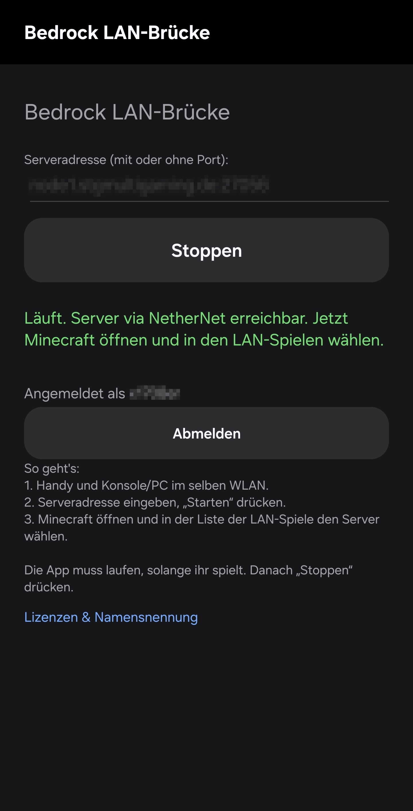

# Bedrock LAN-Brücke

**Language:** English | [Deutsch](README.de.md)

**Free. No ads. Open source.**

**Makes any public Bedrock server show up in Minecraft's LAN list — on console and PC.**
One page, one input field, one button.

  

---

## Download

Download the APK from the latest [release](../../releases) and install it
(allow "unknown sources"). Updates can be installed on top without uninstalling.
The app checks for new releases on startup and shows a download link.

### Play Protect warns you?

That's a heuristic filter for sideloaded APKs, not actual malware detection —
the source code is right here. In the dialog choose **"More details" → "Install anyway"**.

If that button is missing: Play Store → Profile → Play Protect → Settings →
temporarily disable "Scan apps", install, re-enable.

## Privacy

- No ads, no tracking, no analytics.
- The update check only queries the GitHub API; no user data is transmitted.
- Microsoft sign-in stores only the refresh token locally on the device.
- Diagnostics and crash data stay local and are only shared if you export them yourself.

## How to use

1. Install and open the app.
2. Connect your phone and console/PC to the **same Wi-Fi**.
3. Enter the **server address** (e.g. `mc.example.net`).
4. Tap **Start**.
5. In Minecraft, pick the server in the friends/LAN list. Done.

> **Note:** The app has to keep running while you play. Many phone manufacturers
> (Samsung, Xiaomi, Huawei, …) kill background apps "to save battery" — which drops
> the connection mid-game. Instructions for your device:
> [dontkillmyapp.com](https://dontkillmyapp.com)

## Requirements

- Android phone with **Android 8.0** or newer
- Minecraft on console (Switch is **not** supported) or PC
- The server must offer **NetherNet**, i.e. answer `GET /v1/join`
  (current BDS/Geyser versions do that out of the box)
- The app prefers **HTTPS**. If the server only offers **HTTP**, a fallback
  with a visible warning is used

## Online servers: account sign-in

Servers with online mode enabled only accept connections with a real Mojang
multiplayer token. For that, tap **"Sign in with Microsoft account"** at the top of the
app once and enter the shown code at `microsoft.com/link`
(the account you want to play as on the server). The app only stores the refresh
token and automatically obtains XSTS → PlayFab → MCToken → multiplayer token,
embedding it into the WebRTC identity.

**Important:** Mojang's anti-proxy binding (transport identity = login identity)
requires the console's login to be signed with the same key as the app's connection.
The app therefore rewrites the login to the app account: the bridge player appears
on the server as **the app account** (gamertag/XUID of the signed-in Microsoft account),
and only **one** bridge player or **one** connected device can be active at a time. That's the maximum the protocol allows.

---

## Building it yourself

Just fork — under **Actions**, start the **"APK bauen"** workflow manually
(**"Run workflow"**); it produces a signed release APK
(signing key in the repo secrets: `KEYSTORE_BASE64`, `KEYSTORE_PASSWORD`,
`KEYSTORE_ALIAS`, `KEYSTORE_KEY_PASSWORD`).

## Tech (short version)

- **No RakNet at all:** LAN discovery via the official NetherNet protocol (UDP 7551),
  with AES/HMAC per spec
- **WebRTC end-to-end:** one device connects to the app via WebRTC, the app connects to the server via WebRTC
- The app is a WebRTC answerer for one device on the LAN and a WebRTC client towards the server
- Server list, player count, version and nonce come live from the server's `/v1/join` endpoint
- Messages are passed through 1:1 as complete NetherNet frames
- Nintendo Switch is not supported

## Licenses & credits

The project itself is **MIT-licensed** ([LICENSE](LICENSE)).

The app bundles **stream-webrtc-android** (Apache 2.0, including Google's libwebrtc
under BSD-3). Protocol implementations are Java ports of, or derived from:

| Project | License | Basis for |
|---|---|---|
| [df-mc/go-nethernet](https://github.com/df-mc/go-nethernet) | MIT (Dragonfly Tech) | NetherNet LAN discovery, signaling, segment framing, identity assertions |
| [df-mc/nethernet-spec](https://github.com/df-mc/nethernet-spec) | — (spec, no license file) | LAN discovery protocol description |
| [Sandertv/gophertunnel](https://github.com/Sandertv/gophertunnel) | MIT (Sandertv) | Xbox online sign-in (MSA → XSTS → PlayFab → MCToken) |
| [GeyserMC/Geyser](https://github.com/GeyserMC/Geyser) | MIT (GeyserMC) | Transport identity binding, login validation |
| [CloudburstMC/Network](https://github.com/CloudburstMC/Network) | Apache 2.0 (CloudburstMC) | HTTPS/HTTP signaling (`/v1/join`), identity validation |
| [CloudburstMC/Protocol](https://github.com/CloudburstMC/Protocol) | Apache 2.0 (CloudburstMC) | Login envelope format |
| [acacia-rs/acacia](https://github.com/acacia-rs/acacia) | MIT (Hexay) | Authentication chain docs (`docs/auth.md`) |
| [GetStream/webrtc-android](https://github.com/GetStream/webrtc-android) | Apache 2.0 | Bundled WebRTC library |

Full license texts and copyright notices:
[THIRD_PARTY_LICENSES.md](THIRD_PARTY_LICENSES.md)
